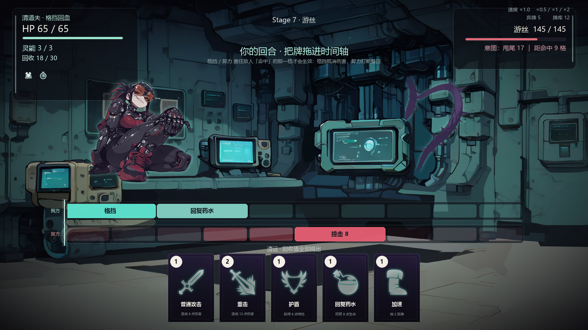
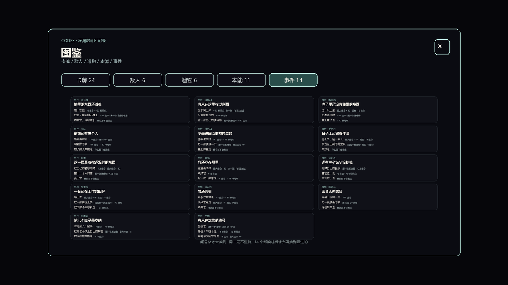
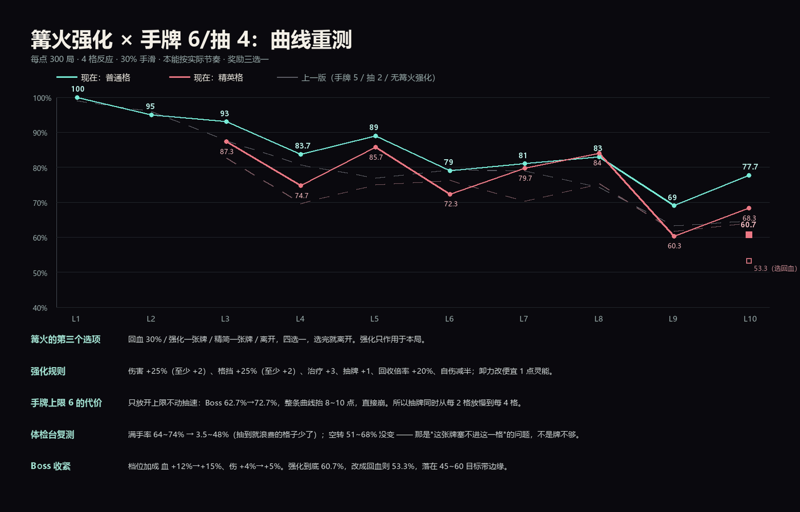
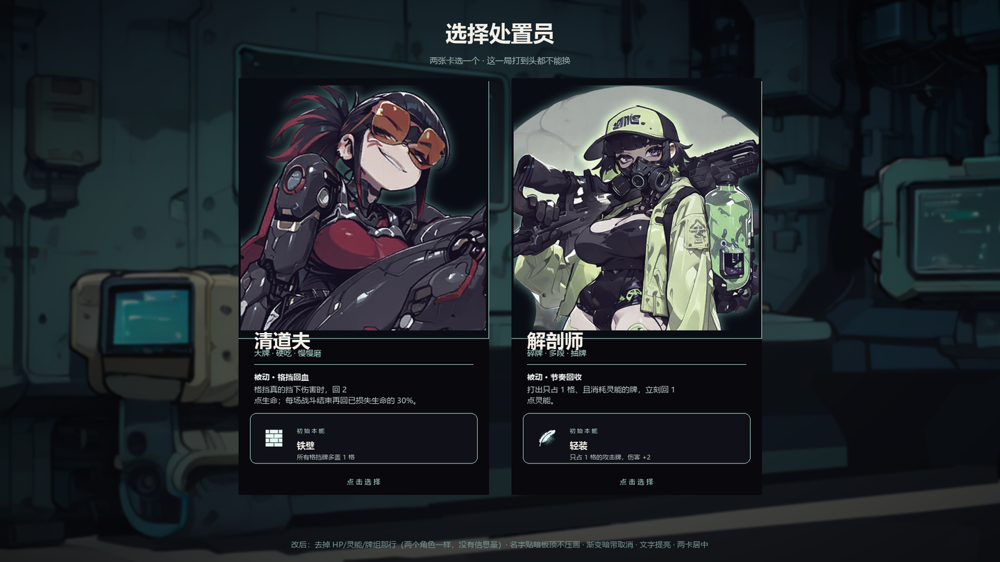
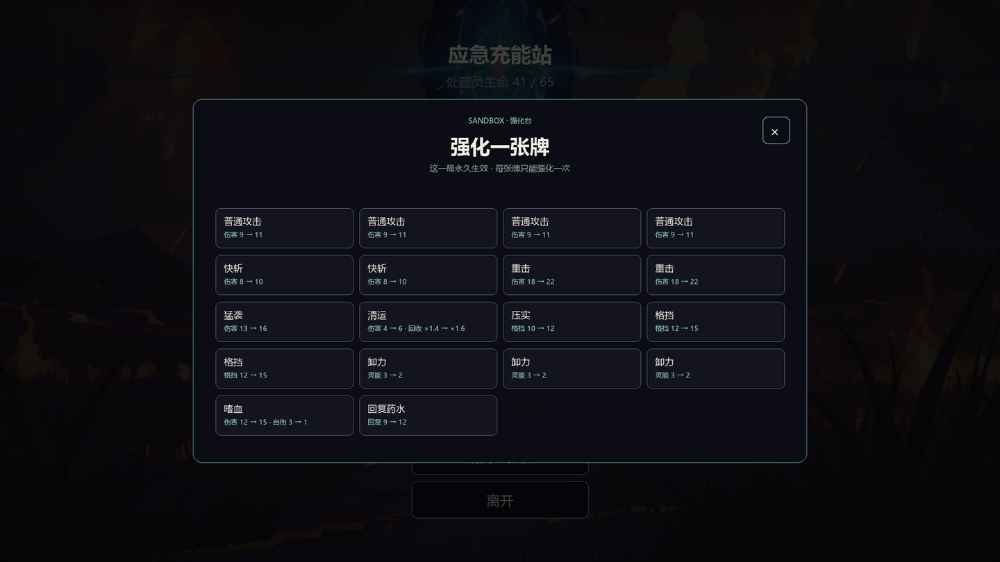
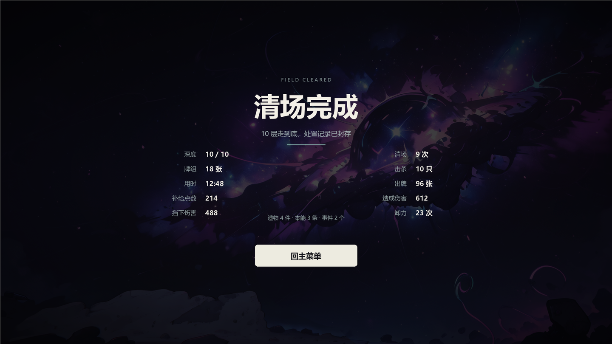

# 牌局 · CardGame

一款用**团结引擎（Tuanjie 1.8.5 / Unity 2022.3 内核）**做的单机卡牌 Roguelike。
核心不是"回合出牌"，而是**时间轴**：每一格是一秒，牌要占格，敌人的招式也占格 —— 你排的不是顺序，是时间。

---

## 下载试玩

**[⬇ CardGame-Windows-x64.zip（约 90 MB）](https://github.com/Chen-zizheng/CardGame/releases/download/v1.0.0/CardGame-Windows-x64.zip)**

解压双击 CardGame.exe，不用装引擎。

> Release 里的安装包还是 **v1.0.0**（两职业、敌人 3 种、7 层的版本）。
> 仓库源码已经走到 **v1.1**：十层、敌人 6 种、遗物 / 本能 / 事件 / 强化全都在里面，但还没重新打包。

---

## 玩法：时间轴就是资源

| 规则 | 说明 |
|---|---|
| **一格 = 1 秒** | 时间轴共 10 格，我方轨道在下面一格一格往右走 |
| **牌要占格** | 每张牌有自己的 Duration，占 1~5 格，期间不能往里塞别的牌 |
| **灵能** | 出牌消耗灵能；**每 2 格回 1 点**，上限 3（清道夫）/ 4（解剖师） |
| **抽牌** | **每 4 格抽 1 张**，手牌上限 6 |
| **格挡要盖住"命中"那一格** | 盾牌占地 3~5 格，只有和敌人招式结算的那一格重叠才算数 |
| **卸力（打断）** | 占 2 格、3 灵能，覆盖命中格就整招取消 —— 但**霸体招**免疫 |
| **霸体** | 带霸体的招式不能被打断，只能硬吃或减伤 |

所以每一回合真正的问题是：**这一击落在第几格、我这几张牌能不能在那之前排到、灵能够不够**。

### 两个职业

| | 清道夫 | 解剖师 |
|---|---|---|
| 灵能上限 | 3 | 4 |
| 被动 | 格挡真的挡下伤害时回 2 点生命 | 打出占 1 格且耗灵能的牌回 1 灵能；每打出 2 张牌回 3 点生命 |
| 手感 | 大牌、硬吃、慢慢磨 | 碎牌、多段、把节奏接起来 |
| 专属牌 | 铁墙 / 扫拖 / 靠住 / 掏底 | 细针 / 剥皮 / 抽髓 / 换气 |

两人都是 65 血；每场战斗结束两职业都**回复已损失生命的 30%**。

### 十层，一层一个守关者

真正会打架的只有 7 层（第 3 / 6 / 9 层是篝火），其余层按权重抽节点：普通 / 精英 / 事件 / 商店。

| 层 | 守关者 | 手法 |
|---|---|---|
| L1 | 史莱姆 · 孵化体 | 教学：预警 9 格、留 2 格喘 |
| L2 | 游丝 · 游弋体 | 预警只有 6 格，逼你提前排 |
| L4 | 鳞蛾 · 飞散体 | 全程不留空档，霸体也挡 |
| L5 / L8 | 锈壳 · 装甲体 | 长预警高伤，卸力只剩一次机会 |
| L7 | 羊巨人 · 培育体 | 霸体最多，卸力基本失效 |
| L10 | 领主 · 母体 | 四招轮转，60% 血进二阶段，换招时给 2 格空档 |

第 5 层起，普通格会带**亚种前缀**：腐蚀的（血少伤高）/ 硬壳的（血厚预警长）/ 狂躁的（预警短）/ 饥饿的（两样都涨）。

---

## 构筑系统

### 卡牌 24 张 + 强化

- 五种类型，同一套颜色贯穿手牌 / 图鉴 / 商店：**攻击砖红 · 格挡薄荷 · 卸力琥珀 · 回复粉 · 抽牌青**
- 篝火可以**强化一张牌**（每张一次）：伤害和格挡 +25%（至少 +2）、治疗 +3、抽牌 +1、卸力便宜 1 点灵能、自伤减半

### 遗物 6 件

秒表 / 橡胶手套 / 拖把桶 / 防毒面具 / 霓虹灯牌 / 结算单 —— 改的是打法，不是数值：
比如「拖把桶」把格挡溢出的一格换成 1 灵能，「霓虹灯牌」给多段攻击每一段 +1。

精英与首领必掉，普通格 20%；商店也卖。

### 本能 11 条

按职业分池，**出生自带一条**，之后每打完第 3 / 6 / 9 层长一条，本局一直有效。
清道夫的六条全押在格挡 / 卸力 / 回收上（铁壁、回击、拾荒、存货、精准卸力、节拍），解剖师五条押在多段和节奏上（轻装、连击、余韵、预判、疾走）。

### 事件 14 个

问号格才会读到。同一局不重复，14 个读完之后才开始重复。
写法有规矩：**第二人称、不说教、代价直接写在选项上、永远留一个"什么都不做"的出口**。
比如「回声井」可以往下丢一张牌换一次随机强化 —— 代价是不回血。

---

## 平衡是怎么做的

没有靠手感，靠一个 **headless 纯逻辑台**：战斗代码（Assets/Scripts/Combat/）零 UnityEngine 引用，
用 mono 编成 exe 跑几十万局，同一套规则、同一个种子。

**口径（不这样测出来的数字不算数）**
- 4 格反应窗口（看到招式后至少有 4 格能反应）
- 30% 手滑（模拟真人漏看）
- 每点 300~600 局
- 单场曲线看"每层胜率"，整局看"十层连乘的通关率"

**现在的数字**

- 单场：普通格 L1~L10 约 100% → 70%，精英格 87% → 60%，首领单场 59%
- 整局：**通关率 42.2%**（600 局，清道夫 41.7% / 解剖师 42.7%，平均死在第 7.7 层）

> 早期版本整局只有 21.3%，而且解剖师 5.5% —— 单场台子每场满血入场，看不见"跨层血量经济"这个断层，
> 是整局模拟把它暴露出来的。

---

## 美术

冷紫环境 + 纯白可染色形状 + 单一薄荷青发光焦点。硬约束落实成几条：

- **禁黑描边**，靠明度分离；敌人只挂一圈极细的薄荷边光（σ ≈ 画面 2%）
- 全屏只允许 3 处发光体；文字只有三级字号
- 卡面 1024×1536：深紫底 + 薄荷矢量图标（[game-icons.net](https://game-icons.net)，CC BY 3.0）
- 界面全部**运行时用代码构建**（没有预制体依赖），因为工程只能在团结引擎里打开

游戏内视觉预览（由校验脚本合成，不是实机截图）：

| 选人 | 篝火强化 | 结算 |
|---|---|---|
|  |  |  |

### 素材声明

怪物立绘取自本地素材库里的手绘画稿，经过双色调（duotone）+ 边光 + 径向渐隐处理，
**仅用于个人自用与研究，不用于发布或分发**。仓库里不含素材库原图，只保留处理后的成品。

---

## 技术结构

| 目录 | 职责 |
|---|---|
| Assets/Scripts/Combat/CombatTypes.cs | 配置常量、事件、SeededRandom |
| Assets/Scripts/Combat/CombatSim.cs | 时间轴推进 / 结算 / 伤害 |
| Assets/Scripts/Combat/CombatContent.cs | 卡表、敌人、亚种、强化规则 |
| Assets/Scripts/Combat/CombatView.cs | 运行时构建的战斗界面 |
| Assets/Scripts/Combat/RelicLibrary.cs | 遗物 |
| Assets/Scripts/Combat/TalentLibrary.cs | 本能 |
| Assets/Scripts/Combat/EventLibrary.cs | 事件 |
| Assets/Scripts/Systems/ | BattleSystem（薄适配器）、MapManager、SaveSystem |
| Assets/Scripts/UI/ | 菜单 / 选人 / 地图 / 商店 / 篝火 / 图鉴 / 暂停 |
| Assets/Scripts/Core/ | GameManager（本局状态） |

- **逻辑与表现分离**：CombatSim 不碰渲染，所以能离线跑平衡
- **存档在战斗外写**：进地图、打赢后、拿完奖励各存一次；中途退出重打当前节点
- **UI 全是代码建**：布局常量集中在各 *Layout.cs，可以单独编译校验（不依赖编辑器）

---

## 运行与构建

| 项 | 值 |
|---|---|
| 引擎 | **团结引擎 1.8.5**（内核 2022.3.62t7） |
| 渲染管线 | Built-in |
| 场景扩展名 | .scene（团结引擎私有格式，**原版 Unity 打不开**） |

1. 用团结引擎 Hub「添加项目」指向仓库根目录
2. 打开 Assets/Scenes/MainMenu.scene，点 Play
3. 构建：File → Build Settings → Windows x86_64

> 中文字体 Assets/TextMesh Pro/Fonts/SIMHEI SDF 1.asset 走 **Git LFS**，克隆后先 `git lfs pull`，否则中文会变方框。

---

## 更新日志

### v1.1（未打包）
- **十层**地图（原 7 层），第 3 / 6 / 9 层固定篝火，与本能发放对齐
- 敌人 3 → **6 种**，加了亚种前缀；首领二阶段换招留 2 格空档
- 卡池 16 → **24 张**，新增「强化一张牌」（篝火 / 事件）
- **遗物** 6 件、**本能** 11 条（按职业分池，出生自带一条）
- **事件** 14 个，含"事件给强化"的新奖励轴
- 抽牌节奏 3 格 → 4 格、手牌上限 5 → 6（配平，单独放开上限会崩）
- 图鉴五页（卡牌 / 敌人 / 遗物 / 本能 / 事件），图标悬停看说明
- 结算屏两列十项统计 + 强化张数
- 全面精简教学式文案

### v1.0.0
- 时间轴战斗、两职业、7 层地图、13 张卡

---

## 致谢

- 卡牌图标：[game-icons.net](https://game-icons.net)（CC BY 3.0）
- 字体：微软雅黑（系统字体，仅本机生成 SDF 资产）
- 引擎：[团结引擎](https://unity.cn/tuanjie)
